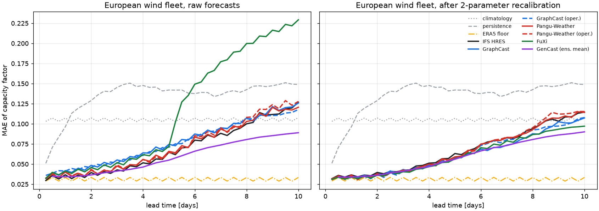
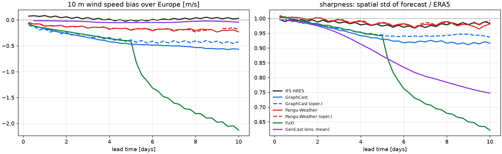
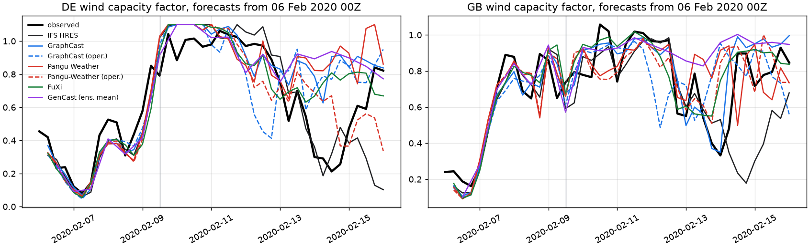
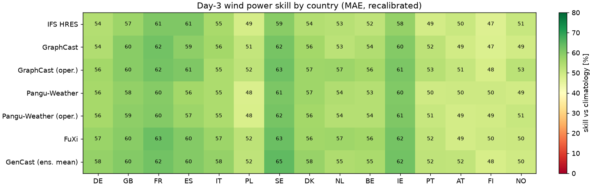
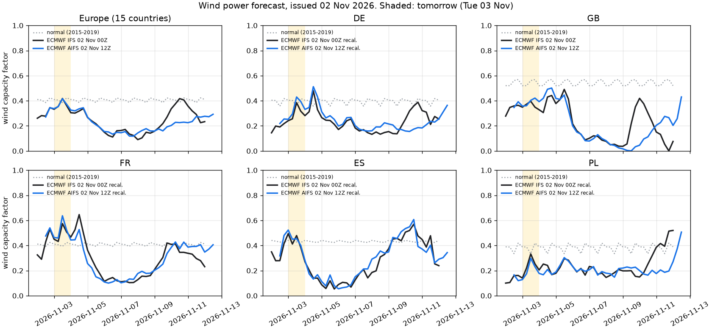
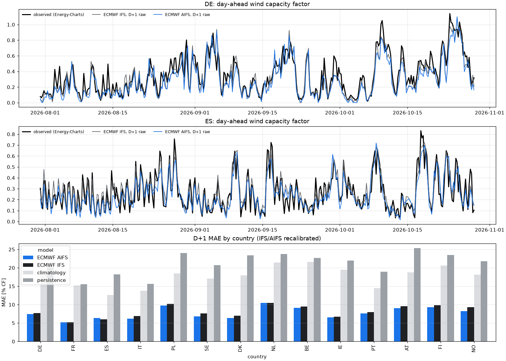

# Weather2Watts

**A small, open check of how AI weather forecasts translate into real wind power.**

[](https://github.com/DavideWasTaken/Weather2Watts/actions/workflows/ci.yml)
[](results/live/latest.md)
[](LICENSE)


AI weather models (GraphCast, Pangu-Weather, FuXi, GenCast, ECMWF AIFS) are usually compared on
weather variables such as Z500 or 2 m temperature. This repository asks a narrower, downstream
question: **do those comparisons still hold once the forecasts are turned into wind power and
checked against what the grid actually produced?**

It converts 10 m wind forecasts into capacity factors for 15 European countries and scores them
against observed hourly generation (ENTSO-E data, via OPSD and Energy-Charts). It also runs the
same pipeline live on ECMWF open data. Everything uses public data and runs on a laptop.

<p align="center"></p>

## In short

- **Mostly, yes.** The pattern known from weather scorecards carries over to wind power: AI
  models are on par with ECMWF's physics model for the first 2–3 days and somewhat better
  beyond that.
- **With one practical catch: bias.** Used raw, the AI forecasts under-predict 10 m wind. That is
  a known side effect of smoothed, MSE-trained forecasts. It costs more in power than in
  weather scores, so the AI models only come out ahead after a simple bias correction.
- **This is a confirmation on a new metric, not a new discovery.** The conversion from wind to
  power is deliberately simple (1.5° cells, 10 m wind, one regression per country). The
  forecasts are far less accurate than commercial power forecasts, so this is a verification
  exercise, not something to act on.

## Benchmark: European wind fleet, Jan–Sep 2020

Mean absolute error of the capacity factor in percentage points, for 548 forecasts initialised at
00/12 UTC, after a two-parameter recalibration per lead time (see [method](#method)). Lower is
better.

| model | init | D+1 | D+3 | D+5 | D+7 | D+10 | raw D+3 | low-wind CSI D+3 | D+5 vs HRES, 95% CI |
|---|---|---|---|---|---|---|---|---|---|
| *ERA5 floor* | – | 3.33 | 3.34 | 3.35 | 3.34 | 3.34 | 3.34 | 0.71 | – |
| GenCast (ens. mean) | ERA5 | 3.39 | 4.10 | 5.60 | 7.30 | 9.01 | 4.12 | 0.58 | -0.71 [-1.23, -0.21] ✓ |
| FuXi | ERA5 | 3.37 | 4.04 | 5.65 | 7.89 | 9.71 | 5.17 | 0.52 | -0.66 [-1.15, -0.16] ✓ |
| Pangu-Weather (oper.) | HRES | 3.64 | 4.22 | 5.69 | 8.34 | 11.53 | 4.91 | 0.54 | -0.62 [-1.16, -0.08] ✓ |
| GraphCast | ERA5 | 3.57 | 4.32 | 5.77 | 7.35 | 10.73 | 5.51 | 0.51 | -0.54 [-1.04, -0.01] ✓ |
| GraphCast (oper.)¹ | HRES | 3.52 | 4.12 | 5.83 | 8.03 | 10.78 | 5.11 | 0.61 | -0.48 [-0.93, -0.01] ✓ |
| Pangu-Weather | ERA5 | 3.56 | 4.25 | 5.90 | 8.31 | 11.42 | 4.75 | 0.49 | -0.41 [-0.93, +0.11] |
| IFS HRES | HRES | 3.66 | 4.23 | 6.31 | 8.28 | 11.46 | 4.28 | 0.59 | – |
| *climatology* | – | 10.71 | 10.71 | 10.70 | 10.75 | 10.77 | 10.71 | 0.00 | – |
| *persistence* | – | 9.62 | 14.53 | 14.20 | 13.60 | 14.90 | 14.53 | 0.16 | – |

✓ = better than IFS HRES with a 95% interval excluding zero (paired moving-block bootstrap,
one-week blocks). From D+1 to D+3 no model differs significantly from HRES, so the order in those
columns is noise. The CI column is at D+5 because that is the first lead where the differences
become measurable. ¹ The operational GraphCast was fine-tuned on HRES data, and WeatherBench2
does not say which years. Overlap with 2020 cannot be ruled out.

## Observations

Each point says what was measured and how much weight it can carry.

**1. Raw AI forecasts under-predict wind, and power amplifies it.** Fed raw into a power model
fitted on reanalysis, IFS HRES gives a better day-3 power forecast (4.28) than GraphCast (5.51) or
FuXi (5.17). The 10 m wind bias grows with lead time, to about −0.5 m/s for GraphCast and
−0.2 m/s for Pangu, while HRES stays unbiased. Smoothing in MSE-trained forecasts is well known;
what this adds is its size in power terms. The comparison depends on calibrating the
conversion on ERA5, which is the usual choice but not the only one.

<p align="center"></p>

**2. After a two-parameter correction, the AI models catch up and then pull ahead.** A linear
recalibration per lead time (`a + b·forecast`, fitted leaving one month out) removes the bias.
After it, five of six AI forecasts beat HRES at day 5 by 0.5–0.7 capacity-factor points. This
matches what WeatherBench2 shows for 10 m wind speed. The evidence covers a single nine-month
period.

**3. At day 1 our conversion, not the weather model, is the main error.** Feeding the verifying
reanalysis into the power model still leaves an error of 3.33, and every model is within 0.35
points of it. This mostly reflects how simple the conversion is: a professional one, with hub
height, a finer grid and plant locations, would lower this floor. The D+1 comparison could then
look different.

**4. FuXi changes behaviour at day 5.** FuXi chains three models (0–5, 5–10 and 10–15 days).
Where the second takes over, the wind bias jumps from −0.4 to −2.1 m/s by day 10, and spatial
variability drops to 62% of ERA5. Raw D+7 power error roughly doubles. The cascade is documented
in the FuXi paper. This shows its effect on a power forecast.

**5. For Pangu, ERA5 vs operational initialisation makes little difference here.** Same weights,
different initial state: the two runs stay within about 0.2 points at every lead, which is less
than the uncertainty of either against HRES.

**6. Lowest-MAE and best event detection pull in different directions.** Recalibration shrinks
long-range forecasts towards the mean. That lowers MAE but means the forecast rarely predicts a
lull. Detection of low-wind events (capacity factor below the 2015–2019 10th percentile) falls
from a CSI of 0.22–0.36 (raw) to 0.00–0.19 (recalibrated) at D+7. This is a general trade-off,
not specific to AI models.

### Storm Ciara, February 2020

Forecasts from 6 Feb 00Z, three days before landfall. Every model gets the ramp-up. They differ in
how long the storm lasts and in the lull on 14–15 Feb.

<p align="center"></p>

### Per-country skill at day 3

<p align="center"></p>

## Live: ECMWF AIFS vs IFS, as wind power

Twice a day a GitHub Action fetches the latest ECMWF **IFS** (physics) and **AIFS** (AI) runs from
ECMWF open data, converts them to capacity factors for the 15 countries, and commits a chart, a
table for the next day ([`results/live/latest.md`](results/live/latest.md)) and an archive of
every run. The archive is what makes an out-of-sample comparison possible later. The forecast
itself is a by-product: its day-ahead error is several times that of commercial wind power
forecasts.

<p align="center"></p>

### 90-day backtest

[`scripts/backtest_live.py`](scripts/backtest_live.py) replays the pipeline on 90 daily 00Z runs
(30 Jul – 27 Oct 2026) from ECMWF's cloud mirrors. It scores them against observed generation from
[Energy-Charts](https://energy-charts.info) in the 14 countries available there; GB is not. The
table gives MAE of the capacity factor in percentage points, averaged over countries, with bias
in brackets:

| forecast | D+1 | D+3 | D+5 |
|---|---|---|---|
| ECMWF AIFS (recal) | 7.7 (+0.0) | 9.4 (+0.0) | 12.2 (+0.0) |
| ECMWF IFS (recal) | 8.1 (+0.0) | 10.2 (-0.0) | 13.7 (-0.0) |
| ECMWF AIFS (raw) | 8.3 (-3.5) | 10.2 (-5.0) | 12.9 (-5.9) |
| ECMWF IFS (raw) | 8.6 (-1.4) | 10.6 (-2.4) | 14.1 (-2.5) |
| climatology | 17.7 (-2.7) | 17.9 (-2.7) | 18.1 (-2.4) |
| persistence | 21.1 (+2.3) | 24.1 (+2.0) | 24.8 (+2.0) |

* **Errors are in the same range as the 2020 benchmark.** For IFS the per-country errors are
  8.1 / 10.2 / 13.7 at D+1 / D+3 / D+5, against 7.3 / 9.1 / 13.2 in 2020. That suggests the
  pipeline still works on today's fleet.
* **AIFS scores better than IFS in 12–13 of 14 countries,** by 0.4 / 0.9 / 1.4 points. Treat this
  as indicative: 90 days of late summer and autumn, and the countries share the same weather, so
  they are not independent samples. It is consistent with ECMWF's own reports on surface wind.
* **Both models under-forecast today's fleet,** AIFS by up to 6 points. Newer turbines produce more
  at the same wind speed than the 2015–2019 power models expect. The live forecast therefore
  applies the per-country, per-lead correction fitted in the backtest
  ([`results/live/recal.json`](results/live/recal.json)). GB and the Europe aggregate have no
  observations here, so they stay uncorrected.

<p align="center"></p>

## Method

* **Truth.** Hourly wind generation from [Open Power System Data](https://data.open-power-system-data.org/time_series/2020-10-06)
  (ENTSO-E Transparency and TSOs) for DE, GB, FR, ES, IT, PL, SE, DK, NL, BE, IE, PT, AT, FI and NO.
  Installed capacity is published inconsistently and grows during the year, so the capacity factor
  uses an *effective capacity*: the trailing one-year 99.5th percentile of output. It only looks
  backwards. "Europe" is the sum of all 15 countries.
* **Forecasts.** 10 m wind speed on the 1.5° grid from the public
  [WeatherBench2](https://weatherbench2.readthedocs.io) archive: IFS HRES, GraphCast (ERA5-init
  and operational), Pangu-Weather (ERA5- and HRES-init), FuXi and the GenCast ensemble mean. The
  same 548 initialisations are used for every model. Valid times run to 30 Sep 2020, when the
  OPSD release ends.
* **Weather → power.** One ridge regression per country on `ws, ws², ws³` at every 1.5° cell in
  a box around the country. It is fitted on ERA5 for 2015–2018, with ridge strength chosen on 2019.
  All forecasts share it, so score differences come from the weather input.
* **Two tracks.** *raw* applies the ERA5 power model directly. *recal* adds `a + b·pred` per model
  and lead, fitted leaving one calendar month out.
* **Baselines.** Climatology (month × hour mean, 2015–2019), persistence (observed capacity factor
  at init time), and the ERA5 floor (the power model fed the verifying ERA5).
* **Uncertainty.** Paired differences against HRES with a moving-block bootstrap (one-week blocks
  of initialisations, 2000 resamples).

## Run it

```bash
pip install -e ".[dev]"
python scripts/download.py        # ~650 MB on disk; ERA5 + 7 forecast archives + OPSD, ~5 min
python scripts/run_benchmark.py   # ~1 min on CPU
python scripts/plot.py            # figures + results/leaderboard.md
pytest                            # synthetic end-to-end test, no downloads
```

Live forecast only (no benchmark data needed, ~5 MB download):

```bash
pip install -e ".[live]"
python scripts/forecast_live.py   # -> results/live/latest.{png,md,json}
python scripts/backtest_live.py   # optional, ~1.5 GB / 30 min: re-fits results/live/recal.json
```

**Add a model:** put its 10 m wind speed on the WB2 1.5° grid as a zarr and add one line to
`MODELS` in [`weather2watts/config.py`](weather2watts/config.py). Or write `data/fc_<name>.npz` with
`ws (init, lead, lat, lon)`, `inits`, `leads` (hours), `lat` and `lon`, cut to the box in
`config.BOX`. `run_benchmark.py` picks up every `fc_*.npz` it finds.

## Limitations

* **Nine months, one region, one variable.** The benchmark covers 2020 only, where OPSD and the
  WB2 archives overlap, and wind only. WB2's AI archives carry no surface radiation, so solar is
  not covered.
* **Coarse conversion.** 1.5° cells and 10 m wind, while turbines sit around 100 m and in terrain
  a 1.5° cell cannot resolve. The ERA5 floor shows how much error this leaves.
* **The effective-capacity proxy lags sudden capacity jumps,** such as new Dutch offshore farms.
  That makes NL the noisiest country.
* **GenCast enters as an ensemble mean,** which is smooth and favoured by MAE. A probabilistic
  track (CRPS over its members) would be the fair comparison.
* **Training-data overlap** with 2020 is ruled out for GraphCast (trained through 2019),
  Pangu-Weather and FuXi (through 2017), per WeatherBench2. It could not be confirmed for GenCast
  or operational GraphCast.
* **Not covered:** proprietary models such as Jua's EPT-2, whose forecasts are not public, and any
  link from wind forecasts to electricity prices.

## Data licenses and credits

OPSD time series: see the [OPSD terms](https://data.open-power-system-data.org/time_series/)
(sourced from ENTSO-E and TSOs). Forecasts and ERA5: [WeatherBench2](https://github.com/google-research/weatherbench2),
which redistributes ECMWF and model-developer data under their respective licenses. Live
forecasts: [ECMWF open data](https://www.ecmwf.int/en/forecasts/datasets/open-data), © ECMWF,
CC BY 4.0. Observed recent generation: [Energy-Charts](https://energy-charts.info). Prompted by
[the EPT-2 report](https://arxiv.org/abs/2507.09703) and [stationbench](https://github.com/juaAI/stationbench).
Code: MIT.
